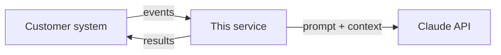

# Integration Diagnostics Extractor

> Turns the evidence customers attach to SSO and API tickets (HAR files, SAML responses, JWTs,
> logs, webhook records) into a cited diagnosis, a customer reply and an escalation report.

**Status:** in progress. Work is tracked as tickets in [backlog/](backlog/README.md).

Part of my Customer Engineer portfolio, built from
[ce-portfolio-template](https://github.com/hpk369/ce-portfolio-template).
All customer data is synthetic: the fictional SaaS "Acme Shield" and its tenants Fernhollow
Financial, Cedarline Health Network and Relaypoint.

## The problem

"SSO broke this morning for everyone. HAR attached." A support engineer spends the first
20 minutes of a ticket like that decoding, comparing and counting before any real thinking
starts. This tool does that part deterministically, and uses an LLM only to weigh the
findings and explain them. When it isn't sure, it says so.

## Demo

- Live demo: <!-- link -->
- Video walkthrough (about 3 minutes): <!-- link -->

## Architecture

<!-- Replace with the context view only you can draw: the customer's systems, external APIs
     and this service, and what data crosses each arrow. -->



The code-level views (components, classes, call graph) are generated on every commit:
[docs/diagrams/architecture.md](docs/diagrams/architecture.md).

## Run it locally

```bash
cp .env.example .env                  # this project's own API key (needed from week 4)
make install                          # uv sync + pre-commit hooks
make check                            # ruff, mypy, pytest
make run                              # Acme Shield on http://127.0.0.1:8000/docs
```

<!-- Then the one command that starts the demo, and what to click or send to see it work. -->

## Key decisions

| ADR | Decision |
| --- | --- |
| [0001](docs/adr/) | <!-- one line --> |

## Docs

- [Integration guide](docs/integration-guide.md): for the customer's engineers
- [Runbook](docs/runbook.md): for whoever is on call
- [Changelog](CHANGELOG.md) and [code diagrams](docs/diagrams/architecture.md)
- [How this repo is set up](docs/template-guide.md): Claude Code rules, CI and workflow

## What I'd do next

<!-- Three bullets: what you'd build with another month, and what a production rollout needs. -->
