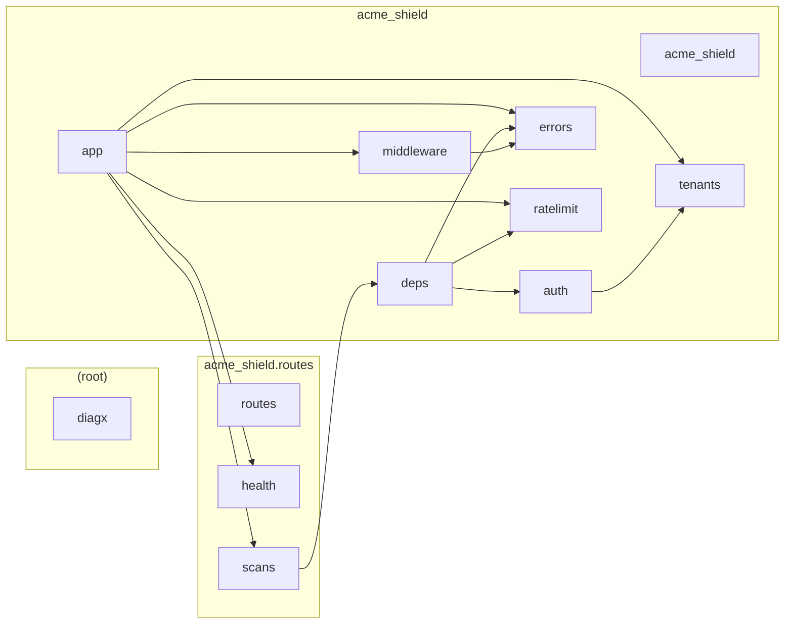
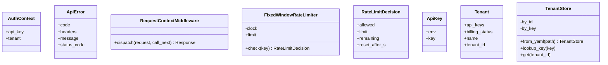
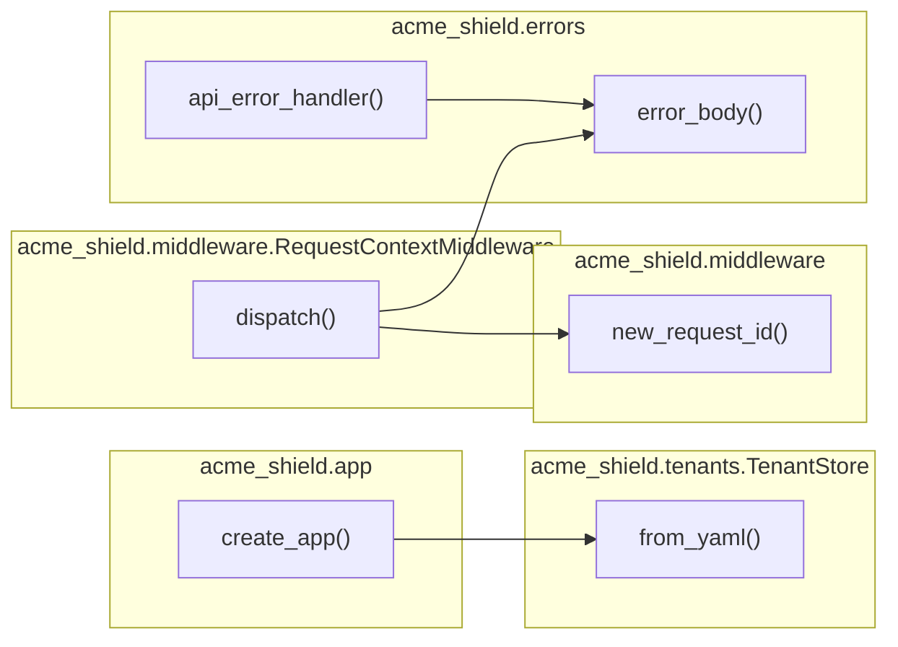

# Code diagrams

<!-- Generated by `python3 .claude/skills/changelog/changelog.py diagrams`. Do not edit:
     the pre-commit hook regenerates this file and CI fails if it is stale. -->

Python modules: 12. TypeScript/JavaScript modules: 0. Classes: 8. Functions and methods: 16.
Tests, tooling and dot-folders are left out.

## Components

Each box is a module, grouped by package; an arrow means "imports" (a component view, like Structurizr).

## Classes

Attributes and methods per class; `+` public, `-` private (underscore or `#`); `<|--` inherits, `<|..` implements (a UML class diagram, like Umbrello).

## Call graph

Which project function calls which, grouped by module (a call graph, like Doxygen). Python only; calls into libraries are left out.

